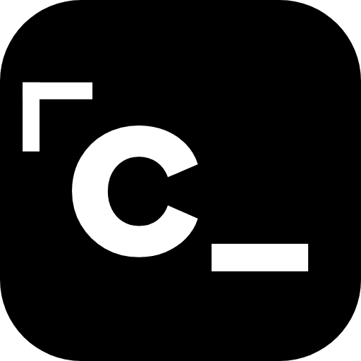
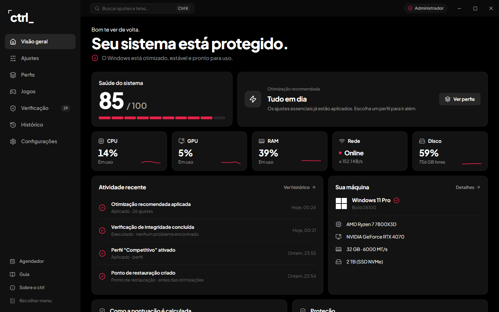
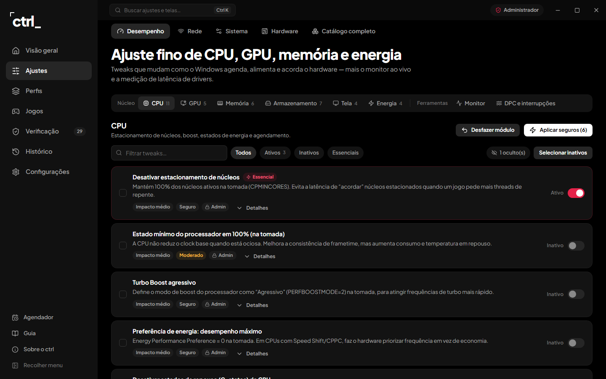
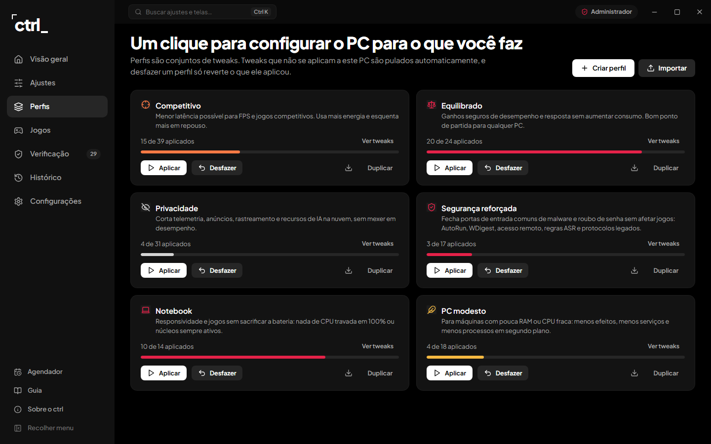
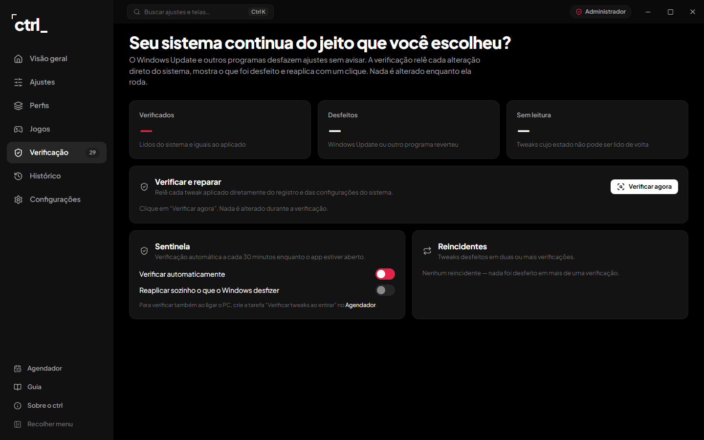
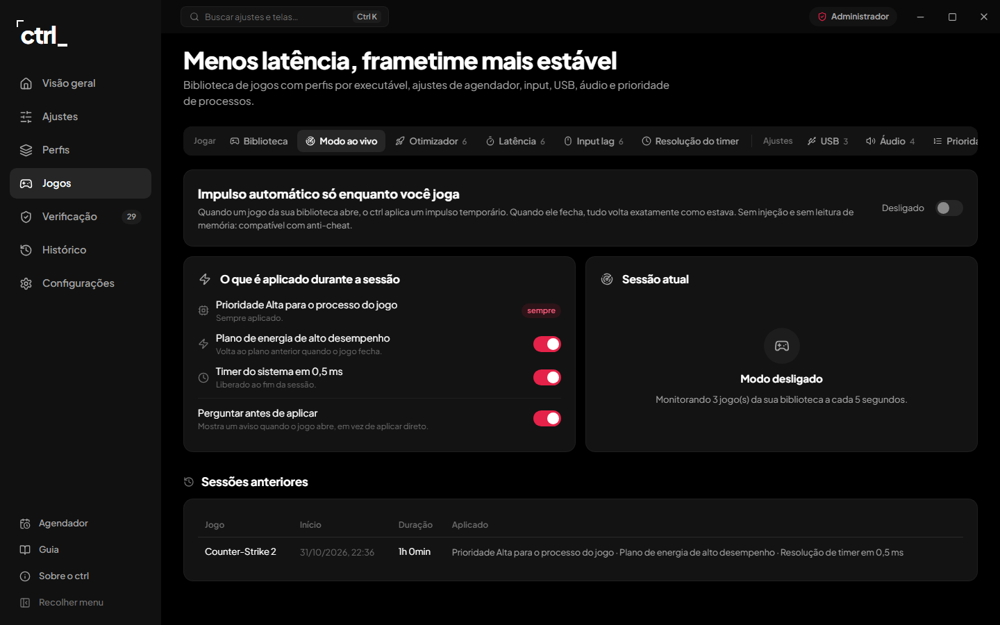

<div align="center">



# ctrl

**Performance, control and stability for your Windows.**
An optimizer that saves the original value of every tweak, checks whether Windows undid anything and
lets you roll back whenever you want.

[**Download for Windows**](../../releases/latest) · [Português](README.md)



</div>

---

> The app interface is in Brazilian Portuguese.

## Why ctrl

Tweak lists and paid optimizers change the registry without telling you what changed, and can't always
undo it. ctrl works the other way around:

- **Nothing changes without a backup.** Before applying a tweak, ctrl saves the original value. Undo puts
  back exactly that value: one tweak, everything from a time window, or everything at once.
- **It checks whether Windows undid it.** Windows updates often revert tweaks silently. **Verification**
  re-reads every change straight from the system and re-applies it in one click. The **Sentinel** does it on
  its own every 30 minutes.
- **Made for your machine.** ctrl detects CPU, GPU, laptop or desktop, Windows 10 or 11, Wi-Fi and more.
  Tweaks that don't fit your hardware are hidden, with the reason shown.
- **No account, no telemetry.** Nothing leaves your PC. The network is only used for tests you ask for and,
  if enabled, to check this GitHub repository for a new version.

## What it does

| | |
|---|---|
| **Overview** | System health from 0 to 100 with the score explained, one-click recommended optimization (essential, safe tweaks only), live CPU, GPU, RAM, network and disk |
| **Tweaks** | **215 tweaks in 28 modules.** Performance (CPU, GPU, memory, storage, display, power, live monitor, driver latency/DPC), Network (latency and jitter, reversible DNS benchmark and switch, TCP and adapter), System (11 fixes such as SFC and DISM, cleanup, Windows Update, privacy, Windows 11, services, startup, built-in apps) and Hardware (specs, disk and battery health, boot time) |
| **Profiles** | Competitive, Balanced, Privacy, Hardened, Laptop and Low-end PC, or your own. Whatever doesn't apply to the machine is skipped. Import and export |
| **Games** | Game library (Steam, Epic or manual) with per-executable tweaks, and **Live mode**: high priority, high-performance power plan and 0.5 ms timer only while the game runs, all restored when it closes. No injection, anti-cheat friendly |
| **Verification** | Re-reads every applied tweak and shows what is fine, what Windows undid and what can't be read. Re-applies in one click and points out repeat offenders |
| **History** | Log of everything ctrl did, undo center (one tweak, last hour, last 24 hours, 7 days or everything) and Windows restore points |

<details>
<summary><b>More screens</b></summary>
<br>
<p align="center">
  
  
  
  
</p>
</details>

## Install

1. Download the latest `ctrl-Setup-<version>.exe` from **[Releases](../../releases/latest)**.
2. Run the installer, read and accept the terms, and pick the folder.
3. ctrl always runs as administrator, because most tweaks change system-wide settings.

> Windows may show "Windows protected your PC" because the installer has no paid code signature. Click
> **More info → Run anyway**.

**Requirements:** Windows 10 or 11, 64-bit.

### Updates

When a new version is out, ctrl shows a notice in the sidebar with a **Download update** button. Install it
over the current one: tweaks, backups and settings are kept. You can turn the check off in
**Configurações → Atualizações**.

## Developers

Electron 33, React 18 and Vite 5 in JavaScript, with Windows PowerShell 5.1 as the executor.

```bash
npm install
npm run dev      # Vite + Electron with hot reload
npm run web      # UI only, in the browser, with a simulated backend (never touches the system)
npm run verify   # lint, quality rules, catalog (structure and syntax of every PowerShell script) and build
npm run dist     # installer at release/ctrl-Setup-<version>.exe
```

The renderer never sends scripts: it sends an IPC channel name and IDs, and the main process looks up what to
run in the catalog. See [docs/architecture.md](docs/architecture.md) (in Portuguese) for the tweak format.

## License

[PolyForm Noncommercial License 1.0.0](LICENSE.md). Personal use, study, research, hobby projects and use by
noncommercial organizations are free. **Selling, reselling or any commercial use is not allowed** without the
author's permission.

## Disclaimer

ctrl changes Windows settings. Every tweak is backed up and can be undone, but **the software is provided
"as is", without warranty of any kind. The author is not liable for any damage to your computer, data loss,
instability or any other loss arising from its use.** By installing it you accept these terms. Keep System
Protection on and a backup of your important files.

<div align="center">
<br>
<sub>Made by <a href="https://github.com/rodolfoxm">rodolfoxm</a> · Copyright © 2026</sub>
</div>
