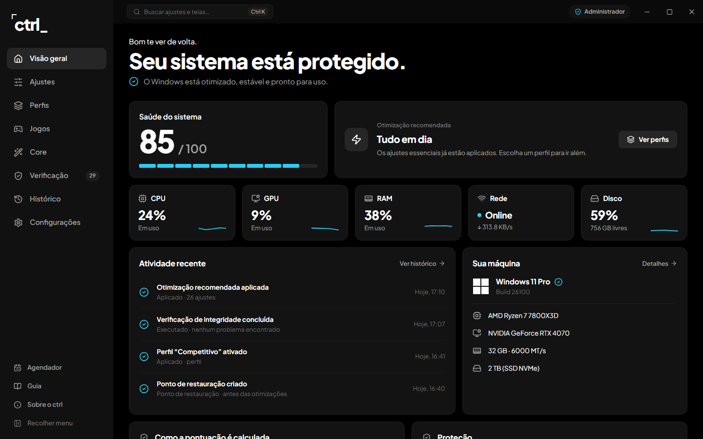
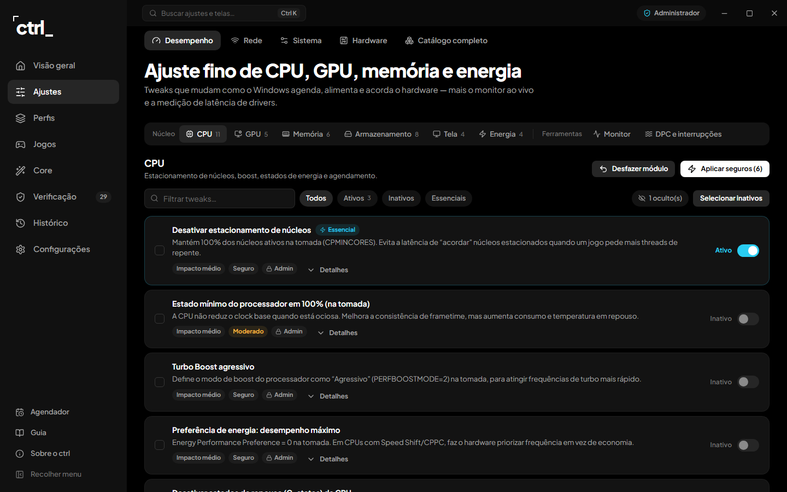
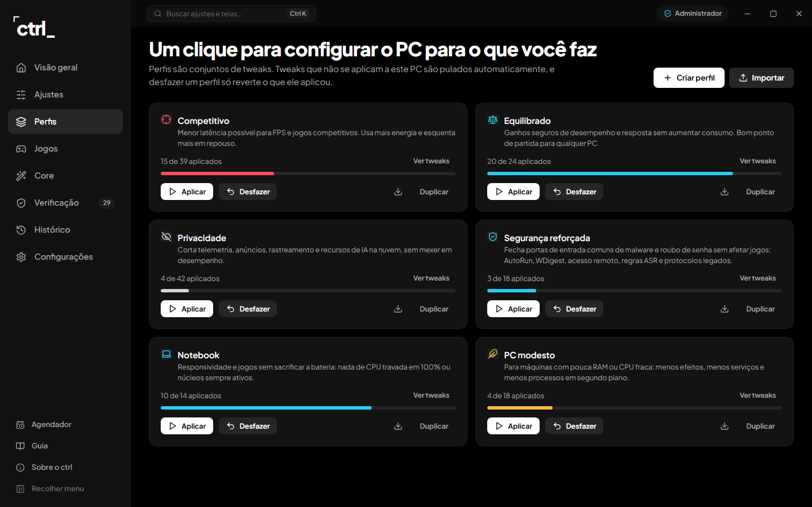
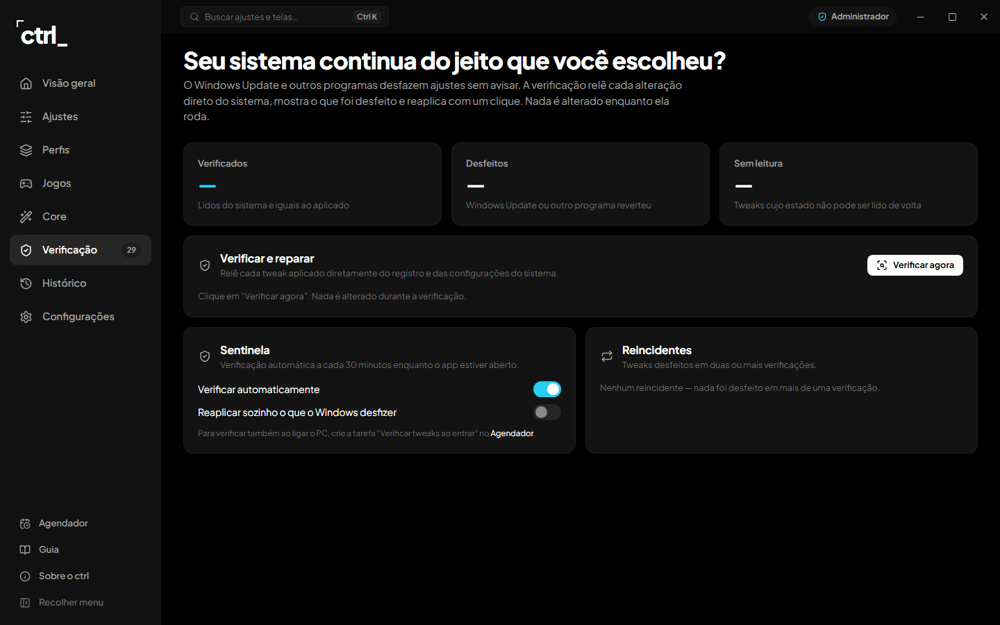
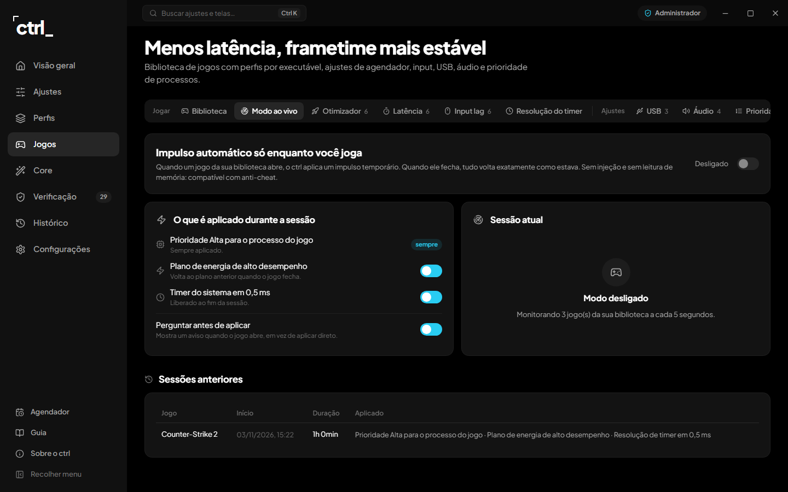
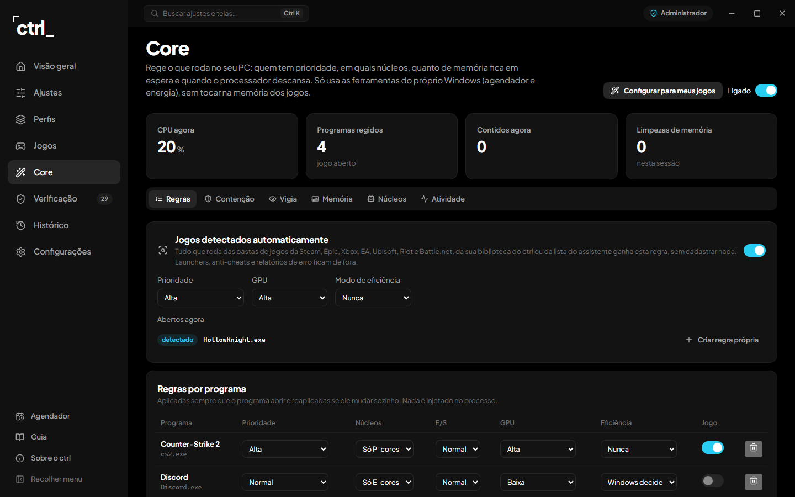

<div align="center">


# ctrl

**Desempenho, controle e estabilidade para o seu Windows.**
Um otimizador que guarda o valor original de cada ajuste, confere se o Windows desfez alguma coisa e
deixa você voltar atrás quando quiser.

[**Baixar para Windows**](../../releases/latest) · [English](README.en.md)



</div>

---

## Por que o ctrl

Listas de "tweaks" na internet e otimizadores pagos mudam o registro sem dizer o que mudaram, e nem
sempre conseguem desfazer. O ctrl foi feito ao contrário:

- **Nada muda sem backup.** Antes de aplicar um ajuste, o ctrl guarda o valor original. Desfazer devolve
  exatamente esse valor: um ajuste, tudo o que foi feito num período ou tudo de uma vez.
- **Ele confere se o Windows desfez.** As atualizações do Windows costumam reverter ajustes sem avisar.
  A **Verificação** relê cada alteração direto do sistema e reaplica com um clique. A **Sentinela** faz isso
  sozinha a cada 30 minutos, inclusive com a janela fechada: o ctrl fica na bandeja, ao lado do relógio.
- **Feito para a sua máquina.** O ctrl detecta CPU, GPU, notebook ou desktop, Windows 10 ou 11, Wi-Fi e
  mais. O que não serve para o seu hardware fica oculto, e ele explica o motivo.
- **Sem conta e sem telemetria.** Nada sai do seu PC. A rede só é usada nos testes que você pede e, se a
  opção estiver ligada, para ver se saiu versão nova aqui no GitHub.

## O que ele faz

| | |
|---|---|
| **Visão geral** | Saúde do sistema de 0 a 100 com a conta explicada, otimização recomendada com um clique (só ajustes essenciais e seguros), CPU, GPU, RAM, rede e disco ao vivo |
| **Ajustes** | **241 ajustes em 28 módulos.** Desempenho (CPU, GPU, memória, armazenamento, tela, energia, monitor ao vivo, latência de drivers/DPC), Rede (latência e jitter, teste de bufferbloat, benchmark e troca de DNS reversível, TCP e placa de rede), Sistema (12 correções como SFC, DISM e ChkDsk, limpeza, Windows Update, privacidade, Windows 11, serviços, inicialização, remoção de apps pré-instalados) e Hardware (especificações, saúde dos discos e da bateria, tempo de boot) |
| **Perfis** | Competitivo, Equilibrado, Privacidade, Segurança reforçada, Notebook e PC modesto, ou os seus. O que não se aplica à máquina é pulado. Importa e exporta |
| **Jogos** | Biblioteca de jogos (Steam, Epic ou manual) com ajustes por executável, e o **Modo ao vivo**: prioridade alta, plano de alto desempenho e timer de 0,5 ms só enquanto o jogo está aberto, tudo restaurado ao fechar. Sem injeção, compatível com anti-cheat |
| **Core** | Rege os processos: prioridade, P-cores ou E-cores, E/S, GPU e modo de eficiência por programa; contém programas de fundo que exageram quando a CPU está carregada; limpa a lista de espera da memória durante os jogos; controla o estacionamento de núcleos e troca o plano de energia conforme o uso. Um assistente pergunta o que você joga e monta a configuração. Só usa o agendador e a energia do Windows, sem tocar na memória dos jogos |
| **Verificação** | Relê cada ajuste aplicado e mostra o que está ok, o que o Windows desfez e o que não dá para ler. Reaplica com um clique e aponta os reincidentes |
| **Histórico** | Registro de tudo o que o ctrl fez, central de desfazer (um ajuste, a última hora, as últimas 24 horas, 7 dias ou tudo) e pontos de restauração do Windows |

<details>
<summary><b>Mais telas</b></summary>
<br>
<p align="center">
  
  
  
  
  
</p>
</details>

## Instalação

1. Baixe o `ctrl-Setup-<versão>.exe` mais recente em **[Releases](../../releases/latest)**.
2. Abra o instalador, leia e aceite os termos, e escolha a pasta.
3. O ctrl abre sempre como administrador, porque a maioria dos ajustes mexe no sistema inteiro.

> O Windows pode mostrar "O Windows protegeu o computador", porque o instalador não tem assinatura digital
> paga. Clique em **Mais informações → Executar assim mesmo**.

**Requisitos:** Windows 10 ou 11, 64 bits.

### Atualizações

Quando sai uma versão nova, o ctrl mostra um aviso na barra lateral com o botão **Baixar atualização**.
Basta instalar por cima: ajustes, backups e configurações são mantidos. Dá para desligar essa consulta em
**Configurações → Atualizações**.

## Usando com segurança

1. **Comece pela Visão geral.** A otimização recomendada só aplica ajustes essenciais: seguros, reversíveis e
   com ganho claro. Um ponto de restauração é criado antes.
2. **Vá além com um perfil**, ou ajuste módulo por módulo em **Ajustes**. Ajustes avançados pedem confirmação e
   mostram o aviso antes.
3. **Reinicie quando pedido.** Um botão aparece no topo quando algo só vale depois de reiniciar.
4. **Arrependeu?** Desligue o interruptor do ajuste ou use **Histórico → Central de desfazer**.

## Perguntas frequentes

<details>
<summary><b>Qual é o ganho real?</b></summary>
<br>
Depende do PC. O maior ganho costuma vir de plano de energia, Game DVR desligado, MMCSS, aceleração do mouse
e processos de fundo. Use o monitor ao vivo e a medição de DPC para comparar antes e depois.
</details>

<details>
<summary><b>Por que alguns ajustes estão ocultos?</b></summary>
<br>
Eles não se aplicam ao seu hardware, como ajustes de AMD num PC NVIDIA ou CPU sempre acordada num notebook.
O motivo aparece em <b>Ajustes → Hardware → Sua máquina</b>.
</details>

<details>
<summary><b>O Modo ao vivo é seguro com anti-cheat?</b></summary>
<br>
Sim. Ele só muda a prioridade do processo, o plano de energia e a resolução do timer, coisas que o próprio
Windows expõe. Não injeta nada nem lê a memória do jogo.
</details>

<details>
<summary><b>O ctrl envia algum dado?</b></summary>
<br>
Não. Não há conta, telemetria nem nuvem. A rede só é usada nos testes que você pede (ping e DNS) e para
consultar a página de versões deste repositório, o que pode ser desligado.
</details>

## Para desenvolvedores

Electron 33, React 18 e Vite 5 em JavaScript, com o Windows PowerShell 5.1 como executor.

```bash
npm install
npm run dev      # Vite + Electron com hot reload
npm run web      # só a interface no navegador, com backend simulado (não toca no sistema)
npm run verify   # lint, regras de qualidade, catálogo (estrutura e sintaxe de todo PowerShell) e build
npm run dist     # instalador em release/ctrl-Setup-<versão>.exe
```

- `node scripts/smoke-readonly.cjs` roda todas as leituras e ferramentas de diagnóstico na máquina real,
  **sem aplicar nada**.
- `node scripts/export-catalog.cjs` atualiza o catálogo usado pelo modo navegador.
- `node scripts/make-brand.mjs` gera o ícone e as imagens do instalador. `node scripts/screenshots.mjs` refaz as
  capturas deste README.

Para criar um ajuste, veja `electron/catalog/` e o formato em [docs/architecture.md](docs/architecture.md).
O renderer nunca envia scripts: ele manda um canal IPC e IDs, e o processo principal procura o que executar
no catálogo. Mais em [PRODUCT.md](PRODUCT.md), [docs/design.md](docs/design.md), [docs/onboarding.md](docs/onboarding.md)
e [docs/quality.md](docs/quality.md).

## Licença

[PolyForm Noncommercial License 1.0.0](LICENSE.md). Uso pessoal, estudo, pesquisa, hobby e uso por
organizações sem fins lucrativos são livres. **Vender, revender ou usar comercialmente não é permitido**
sem autorização do autor.

## Aviso de responsabilidade

O ctrl altera configurações do Windows. Cada ajuste tem backup e pode ser desfeito, mas **o software é
fornecido "como está", sem garantias de nenhum tipo. O autor não se responsabiliza por danos ao computador,
perda de dados, instabilidade ou qualquer outro prejuízo decorrente do uso.** Ao instalar, você aceita
esses termos. Mantenha a Proteção do Sistema ativa e um backup dos seus arquivos importantes.

<div align="center">
<br>
<sub>Feito por <a href="https://github.com/rodolfoxm">rodolfoxm</a> · Copyright © 2026</sub>
</div>
